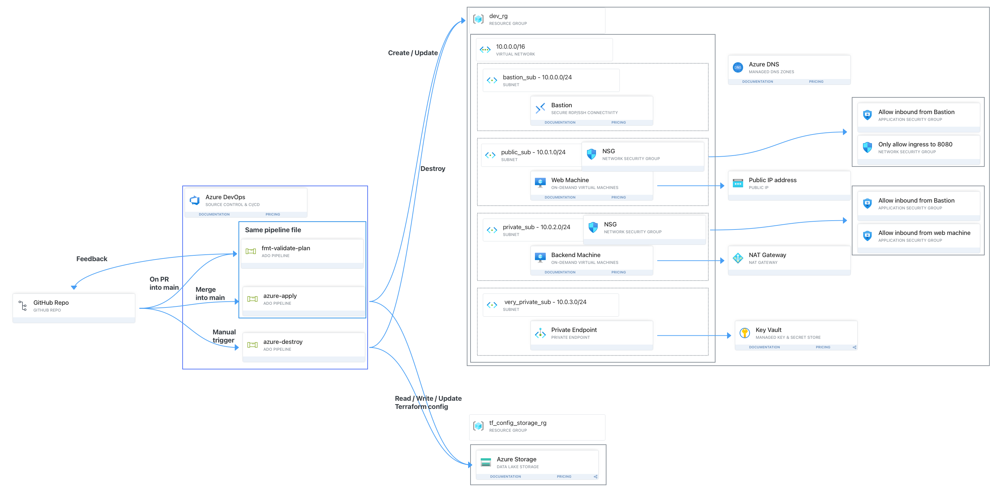

This repository is for training myself on how to use Azure DevOps (ADO) pipelines to use Terraform to deploy infrastructure to Azure. The following is what I have been doing with the most recent at the top. 

### automated_test_4
This test I am going to explore Terraform's modules. But first I want to add load balancing. 

### automated_test_3
This test is going to add another pipeline to monitor if I have left systems up overnight. It will run daily at 2 am and if I have left any systems up overnight it will alert me. This is to ensure I don't leave resources up when I am not using them.  

The pipeline fails if there are resources up, and I have notifications setup in ADO to email me if this pipline fails. 

There wil be no folder for this as it is going to be put into the pipelines folder. 

### automated_test_2
This test will use the two pipelines from the last test, but I am going to upgrade the deployment. Instead of just a single VNet, it will be a mock web service environment with bastion, key vault, NSGs, private endpoint and two Ubuntu machines. See the full plan here:  

I have also split up the main Terraform file into multiple Terraform files for modularity. 

### automated_test_1
This test is now using Azure DevOps pipelines to deploy to Azure. Two ADO pipelines are being created. The first (`pipelines/terraform.yml`) runs on a GitHub PR and merge into `main`, and does the following in different stages:
1. Checks the Terraform format and validates it. 
2. Runs Terraform plan and outputs the plan file as a pipeline artifact. 
3. When merging into main it applies the Terraform config.

If there is an error in the first step, the PR is blocked from being merged into main. 

The second (`pipelines/terraform-destroy.yml`) runs manually and destroys the Azure deployment. 

Both these pipelines get shared variables from the `pipelines/variables.yml` file, and use the `pipelines/templates/setup.yml` template. This template checks out the repo, installs terraform and runs terraform init. Each of these are toggleable through parameters. 

`automated_test_1/` contains a very simple environment to test the pipelines with. 

### manual_test_2
This test went a bit deeper. I used an Azure storage account to remotely store the Terraform config file, and I deployed two machines one of which had a public IP.

### manual_test_1
This test was just to see how Terraform works and how to structure the configuration fies. I manually deployed it using the cli. 
